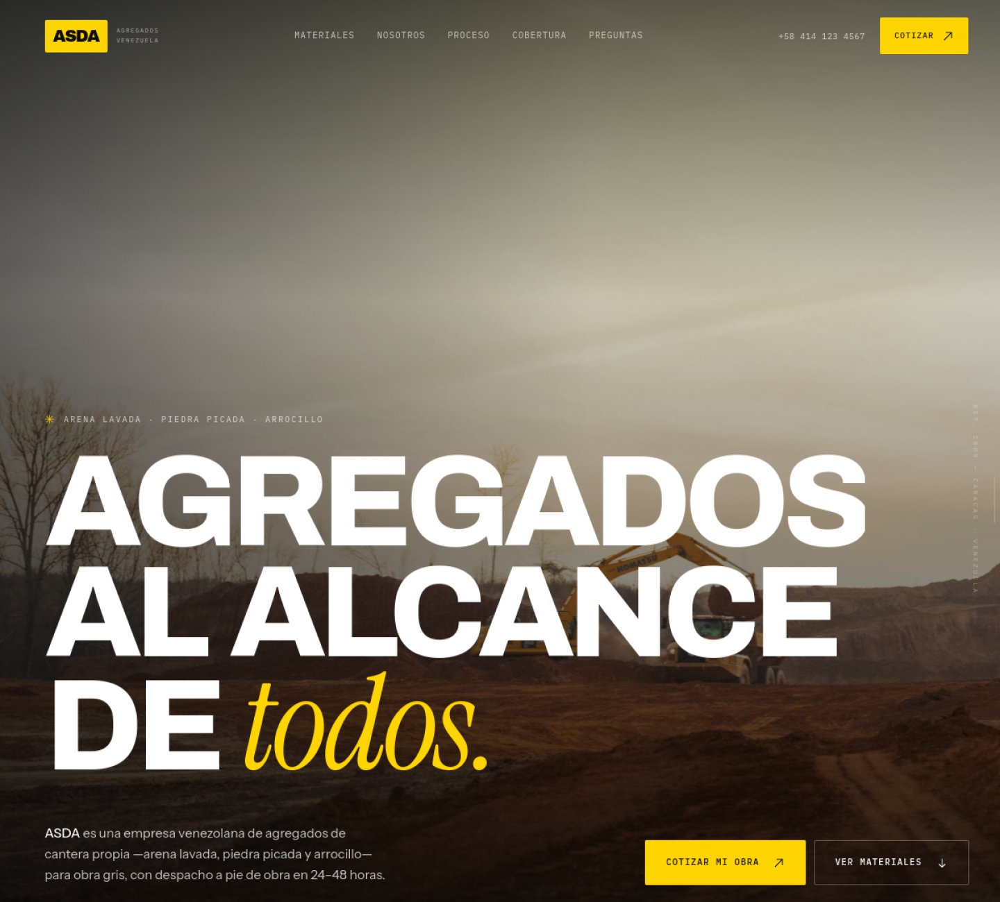
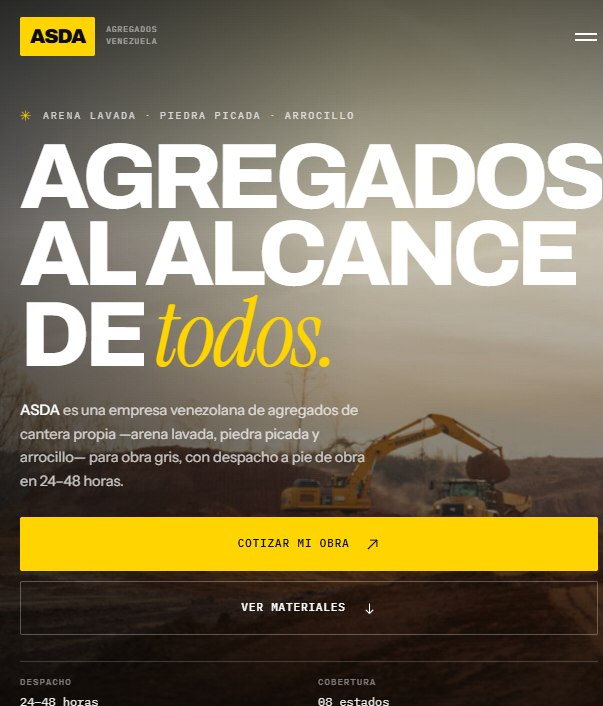

# ASDA — Agregados al alcance de todos

Landing page de una sola página para una empresa venezolana de agregados de construcción (arena lavada, piedra picada y arrocillo). Identidad amarilla/blanca/negra, estética editorial industrial y conversión directa a WhatsApp.

**Marca ficticia:** este proyecto es un caso de estudio de diseño y desarrollo front-end. Los datos de contacto, el RIF y los testimonios son de demostración. El sitio declara `noindex`: no aparece en buscadores y no compite con el dominio del cliente real.

[**Ver el sitio en vivo →**](https://georgemm28d.github.io/asda-web/)



---

## El proyecto

El objetivo era construir una landing que transmitiera **solidez industrial** (cantera propia, despacho a pie de obra, ticket de pesaje) sin caer en el lenguaje visual genérico de las constructoras: azul corporativo, stock photos y tarjetas con sombra.

La dirección de arte parte de una idea simple: **un catálogo impreso de materiales**. De ahí vienen la retícula con líneas de 1 px, la numeración de secciones (01–08), las etiquetas en monoespaciada y el blanco roto (`#f3efe5`) en lugar de blanco puro.

El recorrido de la página sigue el embudo de venta:

`hero → propuesta de valor → catálogo (02) → prueba (03) → proceso (04) → cobertura (05) → cotización (07) → dudas (08)`

---

## Stack

| Capa | Decisión |
|---|---|
| HTML | HTML5 semántico, sin frameworks ni plantillas |
| CSS | Custom properties, Grid, `clamp()`, animaciones con `transform`/`opacity` |
| JS | Vanilla ES2020, ~300 líneas, **0 dependencias** |
| Build | **Ninguno**. Se edita y se publica |
| Hosting | GitHub Pages (rama `main`, carpeta raíz) |

Sin bundler, sin `node_modules`, sin JS de terceros. El sitio completo pesa menos que una sola librería de UI.

---

## Decisiones de diseño

- **Sistema tipográfico de cuatro voces.** `Archivo` variable para titulares (permite ajustar ancho y peso), `Instrument Sans` para texto corrido, `Instrument Serif` itálica como acento editorial y `IBM Plex Mono` para etiquetas, cifras y datos técnicos.
- **Paleta reducida a tres colores.** `--ink: #0c0c0b`, `--paper: #f3efe5`, `--yellow: #ffd400`. El amarillo se reserva para acciones y momentos de énfasis; nunca compite con el contenido.
- **Contraste verificado.** Todos los textos cumplen AA (≥ 4.5:1). Las etiquetas sobre amarillo y sobre negro se ajustaron a `.72` de opacidad para llegar a ~6.8:1.
- **Jerarquía por escala, no por cajas.** Se evitó la tarjeta con sombra: la separación se resuelve con espacio, hairlines y tipografía.
- **Movimiento con propósito.** Los bloques se revelan con un desplazamiento corto (12–24 px); el ticker y el parallax del hero son ambientales. Todo se desactiva con `prefers-reduced-motion`.
- **Microdetalles.** Los contadores arrancan con su valor final (no en cero), el reloj del footer muestra la hora local de Caracas y el formulario arma el mensaje de WhatsApp con los datos ya validados.

---

## Decisiones técnicas

**Revelados a prueba de fallos.** El primer intento usaba solo `IntersectionObserver`, pero los elementos recortados con `clip-path: inset(0 0 100%)` nunca reportaban intersección. Se añadió un chequeo determinista con `requestAnimationFrame` que compara la posición contra el viewport, de modo que el contenido aparece incluso si el observer no dispara.

**Formulario sin backend.** Validación propia (material, volumen, ciudad, presentación, nombre y teléfono) y construcción del `wa.me` con el mensaje prellenado. Incluye estado de error accesible (`aria-live`), foco al primer campo inválido y mensaje de éxito con enlace clicable (no depende de `window.open`).

**Accesibilidad.**
- Enlace de salto, landmarks y jerarquía de encabezados correcta.
- Menú móvil con foco atrapado, `inert` en el resto del documento y devolución del foco al botón.
- `aria-current` sincronizado con el scroll.
- Inputs a 16 px para evitar el zoom automático en iOS; objetivos táctiles ≥ 44 px.
- Foco visible en todos los controles, no solo en enlaces.

**SEO y datos estructurados.**
- `title` y `description` orientados a intención de búsqueda real ("arena lavada, piedra picada y arrocillo en Venezuela").
- Canonical, Open Graph y Twitter Card completos, con imagen 1200×630 local.
- JSON-LD con `@graph`: `Organization`, `LocalBusiness`, `WebSite` y `FAQPage` (7 preguntas, incluidas respuestas citables sobre qué es el arrocillo y cómo se calcula el volumen).
- `noindex` en la demo y `robots.txt` sin sitemap: el sitio queda fuera de los buscadores para no competir con el dominio real del cliente.

**Rendimiento.**
- Seis imágenes propias en WebP (~2.1 MB en total) con `srcset` de 1200/2000 px en el hero y `loading="lazy"` en todo lo que está bajo el pliegue.
- Sin JS de terceros ni fuentes de iconos: los iconos son SVG inline.
- CSS y JS en archivos separados para aprovechar la caché del navegador.

**Responsive.** La retícula pasa de 12 columnas a una sola pila en móvil, el menú se convierte en panel a pantalla completa con foco atrapado y las cifras del hero se reorganizan en dos filas.

<p align="center">
  
</p>

---

## Estructura

```text
asda-web/
├── index.html          # markup + metadatos + JSON-LD
├── styles.css          # sistema de diseño y componentes
├── app.js              # interacciones (~300 líneas)
├── assets/
│   └── img/            # imágenes optimizadas en WebP + og:image
├── docs/               # capturas y social preview
├── robots.txt
└── README.md
```

---

## Cómo ejecutarlo

No requiere instalación: abre `index.html` en el navegador.

Si prefieres servirlo por HTTP (recomendado para probar rutas y metadatos):

```bash
python -m http.server 8000
# http://localhost:8000
```

Para publicar: sube los archivos a la rama `main` y activa GitHub Pages con *Deploy from a branch → main → / (root)*.

---

## Lo que haría en un proyecto real

1. **Formulario con backend** (Netlify Forms, Formspree o una función serverless) y notificación al equipo comercial, en lugar del deep link de WhatsApp.
2. **Datos reales**: teléfono, RIF, dirección y testimonios verificables. Hoy son ficticios y están declarados como tales.
3. **Catálogo escalable**: una ficha por producto y páginas por ciudad, con `Product`/`Offer` en JSON-LD para captar búsquedas locales ("piedra picada Caracas").
4. **Fuentes autoalojadas** con subconjuntos `latin` para eliminar la dependencia de Google Fonts.
5. **Pruebas automatizadas**: `axe-core` y Lighthouse en CI en cada *push*.

---

## Créditos

- Fotografías: [Unsplash](https://unsplash.com) (`photo-1751054619908`, `photo-1635604027975`, `photo-1671366673878`, `photo-1684067241390`, `photo-1687363480913`) y [Pexels](https://www.pexels.com) (#13973799). Se redistribuyen como parte de la demo según sus licencias.
- Tipografías: Archivo, Instrument Sans, Instrument Serif e IBM Plex Mono, vía Google Fonts (SIL Open Font License).
- Diseño y desarrollo: [@georgemm28d](https://github.com/georgemm28d).

## Licencia

Código bajo [MIT](LICENSE). Las fotografías y tipografías conservan sus licencias originales.

---

### English summary

A single-page landing site for a fictional Venezuelan construction-aggregates company. Built with semantic HTML, custom-property CSS and ~300 lines of dependency-free JavaScript, with no build step. Focus areas: editorial art direction, WCAG AA contrast, accessible mobile navigation, native form-to-WhatsApp conversion, structured data (`Organization`, `LocalBusiness`, `WebSite`, `FAQPage`) and self-hosted WebP imagery.
